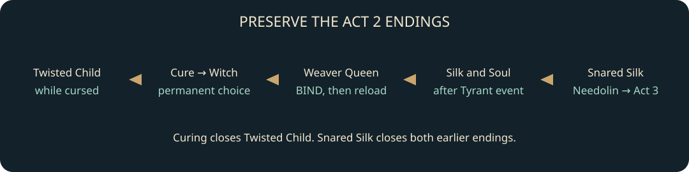

# The safe ending sequence

The irreversible choices are curing the Cursed Crest and triggering Snared Silk. The sequence below preserves the compatible endings in a Classic playthrough.

### 1. Finish the Act 2 checks
Complete the checkpoint chapter first, especially Lumble, the two optional duels, disappearing wishes, deliveries and the second Tyrant. Accepting Silk and Soul already stops the invasion; waiting until the Act 3 transition to check is too late.

### 2. Rite of Rebirth and Twisted Child
- [ ] Find Twisted Bud in hidden Bilewater, via the concealed upper passage from eastern Whispering Vaults and the descending route.
- [ ] Take it to Greyroot in Shellwood; complete Rite of the Pollip and Rite of Rebirth to acquire the Cursed Crest.
- [ ] While still cursed, defeat Grand Mother Silk for Twisted Child.
- [ ] After the credits, reload the save in Act 2.

The curse restricts tools, Silk skills, normal binding, Eva, deliveries and crest access. These restrictions are temporary, but curing permanently closes Twisted Child on this save. **Do not complete Infestation Operation before seeing this ending.** [Twisted Bud](https://hollowknight.wiki/w/Twisted_Bud), [Cursed Crest](https://hollowknight.wiki/w/Cursed_Crest)

### 3. Cure, Witch Crest and Eva
- [ ] Visit Yarnaby in Greymoor while cursed and complete Infestation Operation using the Steel Spines.
- [ ] Receive Witch Crest.
- [ ] Return to Eva for available slot rewards and crest upgrades.

Eva’s thresholds are 12, 20, 27 and 32 eligible slots. Hunter’s own slots do not count. Fully upgraded Wanderer, Reaper, Beast and Architect provide 26; Witch can take you to the final threshold before the Act 3 Shaman Crest. Therefore the final Eva reward does not require entering Act 3 first. [Eva](https://hollowknight.wiki/w/Eva), [Infestation Operation](https://hollowknight.wiki/w/Infestation_Operation)

### 4. Weaver Queen
- [ ] Defeat Grand Mother Silk while uncursed and use BIND for Weaver Queen.
- [ ] Reload after the credits; finish any remaining Act 2 interactions.

### 5. Silk and Soul, then Snared Silk
- [ ] Accept Silk and Soul only after the Bone Bottom invasion checks.
- [ ] Gather Maiden’s Soul, Hermit’s Soul, Seeker’s Soul and Snare Setter; complete the Soul Snare preparation.
- [ ] Defeat Grand Mother Silk and choose the Needolin interaction for Snared Silk.

This advances the save into Act 3 and permanently closes Weaver Queen and Twisted Child. Finish them first. Do available wishes broadly rather than relying on the minimum quest-point threshold for unlocking Silk and Soul. [Silk and Soul](https://hollowknight.wiki/w/Silk_and_Soul), [Endings](https://hollowknight.wiki/w/Endings_%28Silksong%29)

### 6. Lost Lace and Passing of the Age
Continue with the Act 3 chapter. Lost Lace returns you to the final bench after completion. To see the additional Passing of the Age outcome, complete the Mister Mushroom chain before the final victory, or defeat the final boss once before and once after the chain if you want both cinematic variants. [Passing of the Age](https://hollowknight.wiki/w/Passing_of_the_Age_%28Wish%29)
