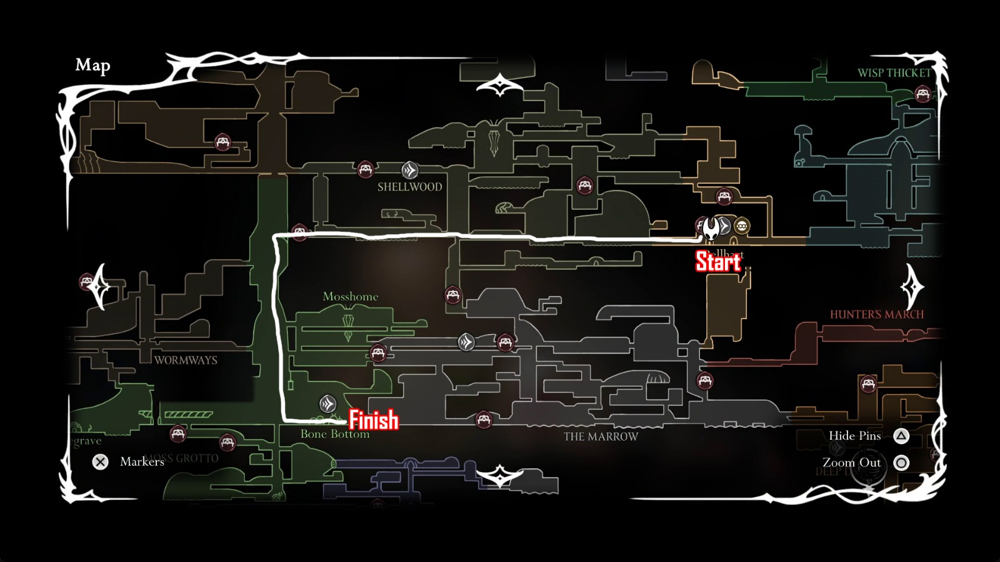
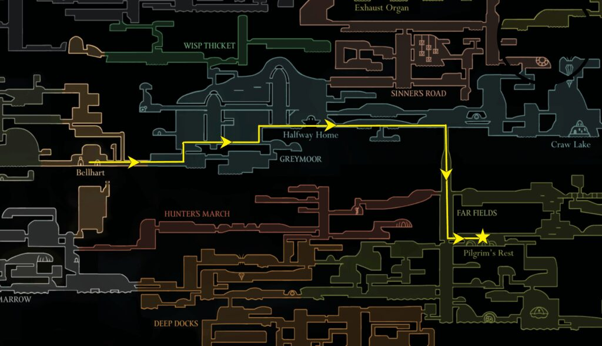
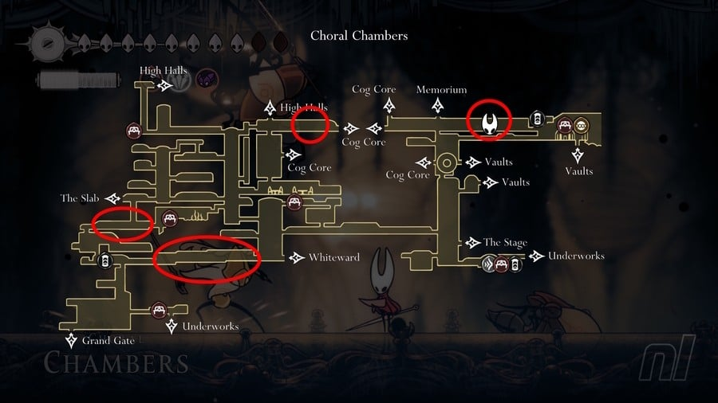

# Maps, sources and credits

### Courier maps
Open the publisher’s walkthrough alongside the image. Route markings show traversal, not immunity from parcel damage. Avoid fast travel while carrying supplies.

[Bone Bottom Supplies walkthrough — Neoseeker](https://www.neoseeker.com/hollow-knight-silksong/Bone_Bottom_Supplies). Map and annotations credited to the linked publisher; game imagery © Team Cherry.

[Pilgrim’s Rest Supplies walkthrough — Gamerpillar](https://gamerpillar.com/pilgrims-rest-supplies-walkthrough-hollow-knight-silksong/). Map and annotations credited to Gamerpillar; game imagery © Team Cherry.

### Second Sentinel meeting locations

[Final Audience and Cogwork Heart guide — Nintendo Life](https://www.nintendolife.com/guides/hollow-knight-silksong-final-audience-quest-where-to-find-the-cogwork-heart-and-second-sentinel). These are encounter locations, not a single marker for every Cogheart fragment. Map and annotations credited to Nintendo Life; game imagery © Team Cherry.

### Interactive locations
Every catalogue entry with a map link opens its location on [MapGenie’s Pharloom map](https://mapgenie.io/hollow-knight-silksong/maps/pharloom). External maps may have their own account or access requirements. Locations supplement, rather than replace, quest prerequisites.

### Data provenance
Names, collection descriptions and map links derive from [Silksong Completionist](https://github.com/Br3zzly/silksong-completionist), commit 7f85ff6146516f913065143c67e3402247557e8c. The upstream MIT notice is preserved in licenses/silksong-completionist.txt. Catalogue generation is repeatable with scripts/import-catalog.mjs and an upstream checkout.

The route’s timing and branch advice uses the Hollow Knight Wiki pages linked in each chapter. Useful references include [Endings](https://hollowknight.wiki/w/Endings_%28Silksong%29), [Wishes](https://hollowknight.wiki/w/Wish), [Hunter’s Journal](https://hollowknight.wiki/w/Hunter%27s_Journal_%28Silksong%29), [Materium](https://hollowknight.wiki/w/Materium) and [Enemy Gauntlets](https://hollowknight.wiki/w/Enemy_Gauntlets_%28Silksong%29).

Reviewed 18 November 2026. Community sources can change and contain mistakes. The catalogue is a planning inventory, not proof that every variant is simultaneously obtainable. No claim is made that the work-in-progress upstream secrets list exhausts every environmental interaction.

### Rights and hosting
This is an unofficial fan guide, unaffiliated with Team Cherry. Game names, artwork and screenshots belong to their respective owners. Third-party maps retain their publishers’ rights and are not covered by the code licence. The original ending diagram and site code are included with this repository.

GitHub Pages from a private organization repository requires GitHub Team or Enterprise. On the Free plan, keep this repository private and use the built site locally until a supported plan or a separately approved hosting arrangement is available. [GitHub Pages availability](https://docs.github.com/en/pages/getting-started-with-github-pages/creating-a-github-pages-site)
